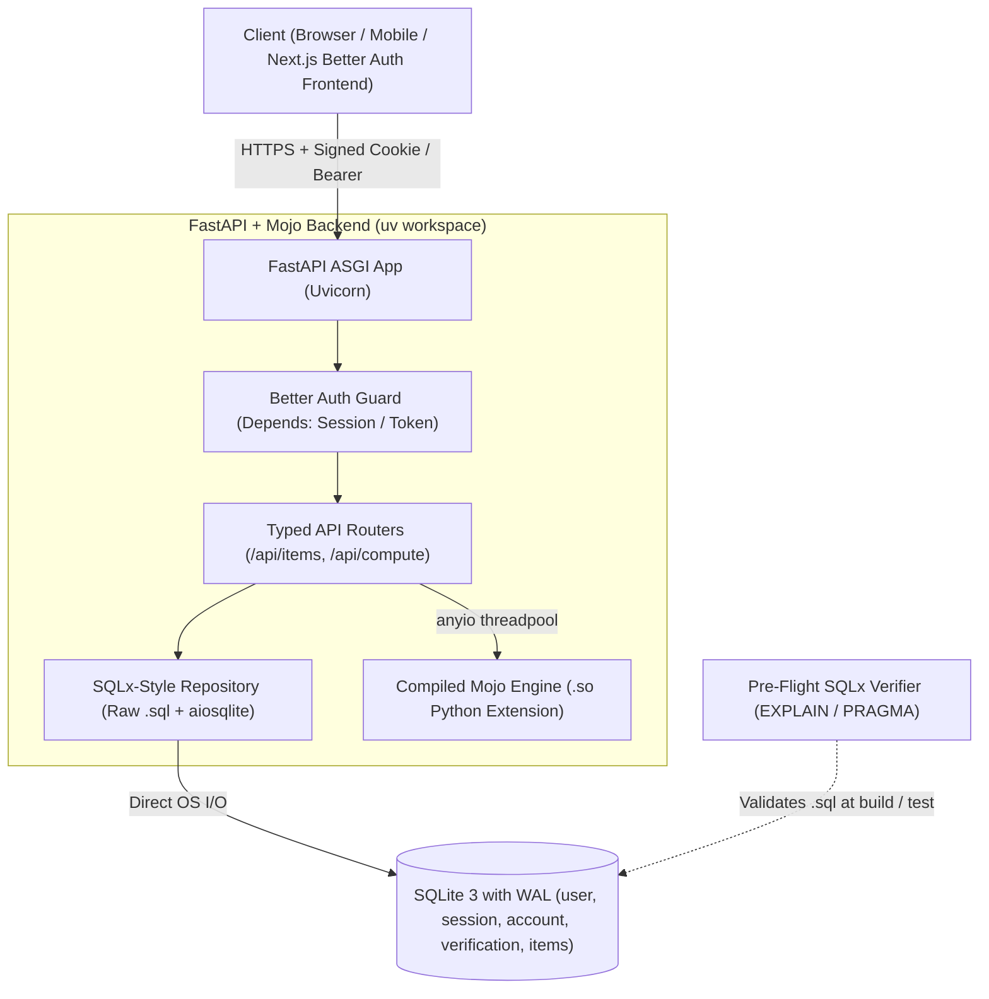

# Production Backend: FastAPI + Systems Mojo + SQLx-Style SQLite + Better Auth

This directory contains the production-grade backend demonstrating how to combine **Mojo (v1.2+)** as a high-performance compute engine with **FastAPI**, **SQLx-style SQLite persistence**, and **Better Auth-compatible authentication**.

---

## Architecture Overview



---

## Key Highlights

1. **Native Mojo Python Extension (`mojo_core.so`)**:
   Instead of running fragile raw socket HTTP in Mojo, Mojo compiles into a native shared library via `PythonModuleBuilder` and `mojo build --emit shared-lib`. FastAPI imports `mojo_core` directly, achieving sub-millisecond SIMD calculations with zero network or subprocess overhead.
2. **SQLx Philosophy with SQLite (`aiosqlite`)**:
   - Zero ORM abstractions: all queries are written in raw, parameterized `.sql` files (`queries/auth.sql`, `queries/items.sql`).
   - Versioned migrations (`migrations/0001_better_auth.sql`, `0002_app_items.sql`) tracked in `_schema_migrations`.
   - Pre-flight SQL query verifier (`python -m backend.app.db.verifier`) using `EXPLAIN` to catch schema mismatches before deployment.
3. **Better Auth Specification**:
   - Exact four-table schema: `user`, `session`, `account`, `verification`.
   - **Argon2id** password hashing (`argon2-cffi`).
   - HMAC-SHA256 signed `HttpOnly; SameSite=Lax` session cookies (`better-auth.session_token`).
   - Composable FastAPI dependencies (`CurrentUser = Annotated[User, Depends(require_user)]`).

---

## Quickstart

### 1. Compile the Mojo Native Extension
```bash
uv run mojo build --emit shared-lib backend/mojo_core/compute.mojo -o backend/app/mojo_core.so
```

### 2. Run Database Migrations & Pre-Flight SQL Verifier
```bash
uv run python -m backend.app.db.migrator
uv run python -m backend.app.db.verifier
```

### 3. Start the FastAPI Development Server
```bash
uv run uvicorn backend.app.main:app --reload
```
The server will be available at `http://127.0.0.1:8000`. You can explore the interactive OpenAPI documentation at `http://127.0.0.1:8000/docs`.

---

## API Testing with `curl`

### 1. Register a New User
```bash
curl -i -X POST http://127.0.0.1:8000/api/auth/sign-up/email \
  -H "Content-Type: application/json" \
  -d '{"name": "Alice", "email": "alice@example.com", "password": "SuperSecretPassword123!"}' \
  -c cookies.txt
```

### 2. Verify Session
```bash
curl -i -X GET http://127.0.0.1:8000/api/auth/get-session \
  -b cookies.txt
```

### 3. Create an Item
```bash
curl -i -X POST http://127.0.0.1:8000/api/items \
  -b cookies.txt \
  -H "Content-Type: application/json" \
  -d '{"title": "Server Risk Profile", "initial_score": 12.5}'
```

### 4. Run High-Performance Mojo SIMD Batch Scoring
```bash
curl -i -X POST http://127.0.0.1:8000/api/compute/batch-score \
  -b cookies.txt \
  -H "Content-Type: application/json" \
  -d '{"custom_features": [1.0, 2.5, 3.8, 4.2, 5.0, 6.1, 7.4, 8.9]}'
```

---

## Running the Automated Test Suite
```bash
uv run pytest backend/tests/ -v
```
